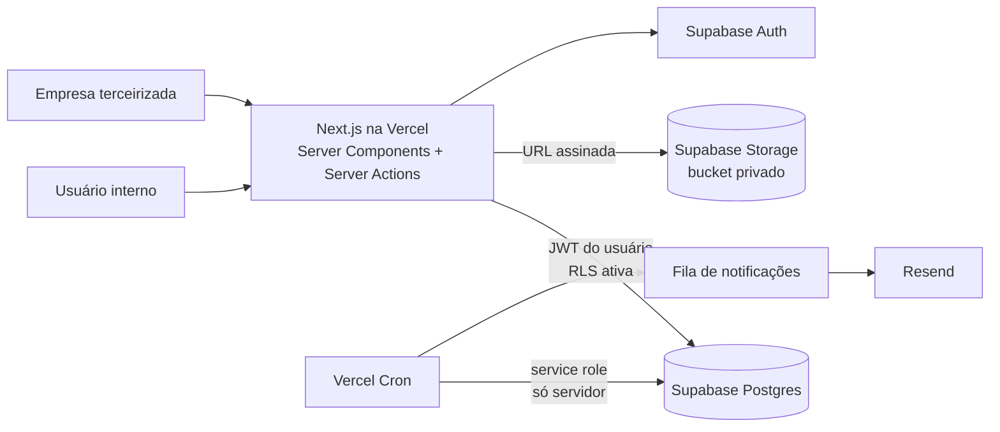
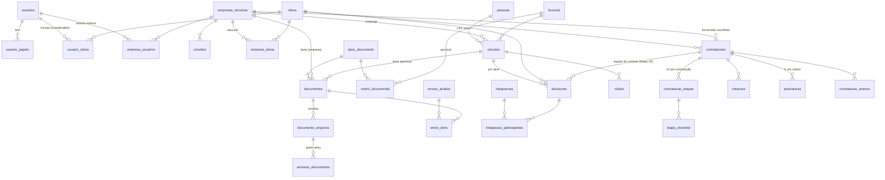

# Etapa 0: Arquitetura da Central de Contratos

**Status:** proposta, aguardando aprovação. Nenhum código de produção foi escrito.
**Data:** 10/11/2026
**Base:** `prototipo-contratacao.html` (versão 5 publicada) e `BRIEFING-sistema-contratos.md`.

---

## 1. Análise da estrutura existente

### 1.1 O que o protótipo é
Um arquivo HTML único, com JavaScript puro e sem servidor. Ele guarda o estado em `localStorage`, tem os perfis simulados num seletor "Ver como" e roteia as telas pelo `#hash`.

### 1.2 Regras de negócio que já estão codificadas (precisam ser preservadas)
| Regra | Onde está no protótipo |
|---|---|
| 12 etapas, com dependências: 7→9 e 10→11 correm em paralelo depois da 6, e a 12 espera a 9 e a 11 | `ETAPAS[].deps`, `liberar()` |
| Prazos 7 d (etapa 7), 3 d (etapa 9), 2 d úteis (etapas 10 e 11); as outras etapas ficam "a definir" | `ETAPAS[].sla/uteis`, `prazo()` |
| Situação do prazo: no prazo, vence hoje ou em 1 dia, atrasada | `prazo()` |
| Etapa só concluída com o checklist completo e os campos obrigatórios preenchidos (nº da solicitação no Sienge, código do contrato, valor negociado) | `prontaParaConcluir()` |
| Etapa 2 exige 3 cotações | idem |
| Obra escolhe fornecedor e valor quando o orçado é **< R$ 4.000**; caso contrário, quem escolhe é Suprimentos na etapa 5 | `LIMITE`, `cotacoes()` |
| A obra pode pular a etapa 3 | `data-a="pular"` |
| Etapa 6 só tem "Autorizar" | `autorizar:true` |
| Assinaturas em ordem fixa (Coordenador → Suprimentos → Fornecedor → Direção → RH); quem registra a do fornecedor é Contratos | `ASSIN` |
| Abertura exige obra, serviço, valor orçado e tipo de contrato | submit `fNova` |
| Matriz documental (empresa, funcionário, sócio diário), NR-10 para eletricidade, NR-05 com mais de 5 pessoas | `DD`, `reqP`, `reqE` |
| Validades: ASO 1 ano, NRs 2 anos, RG/CNH 10 anos; CND, PCMSO, PGR e LTCAT com data informada | `vencDoc()` |
| Documento vencido não é aceito; reprovar exige motivo e um novo arquivo | `pronto()`, `rej` |
| Prazo do RH: 2 dias úteis a partir do envio | `prazoRH()` |
| Integração: aprovado até as 18h entra no próximo dia útil; depois disso, no dia útil seguinte | `dataIntegracao()` |
| Ninguém é liberado com os documentos da empresa ainda não aprovados | `concluirRev()` |
| Sócio esporádico: pedido de visita com pelo menos 1 dia de antecedência e documento com foto | `fFunc` |

### 1.3 Lacunas do protótipo (o que não pode ir para produção como está)
1. Não há autenticação nem autorização no servidor. As permissões só existem na tela.
2. Os arquivos não são armazenados: o protótipo guarda só o nome.
3. Os e-mails são simulados.
4. Cálculos de data no fuso do navegador, sem feriados.
5. **Duplicações:** os "funcionários" da etapa 10 da contratação não se ligam ao módulo de terceiros. O fornecedor da contratação é texto livre e não aponta para uma empresa cadastrada.
6. A pessoa pertence a uma única empresa. Não há histórico pelo CPF.
7. A liberação vale para a pessoa, não para a obra.
8. Os nomes das pessoas responsáveis (Pamela, Taiana, Elaine) estão fixos no código.
9. Não há trilha de auditoria confiável nem registro de quem abriu cada documento.
10. Não existe cancelamento de contratação nem reabertura de etapa.

---

## 2. Arquitetura definitiva

### 2.1 Visão geral
**Monólito modular** em Next.js (App Router) na Vercel, com Supabase como banco, login e armazenamento de arquivos.



### 2.2 Decisões e justificativas
| # | Decisão | Por quê |
|---|---|---|
| D1 | Monólito modular (não microsserviços) | Uma empresa usa, a equipe é pequena e o deploy fica simples. Os módulos ficam separados por pasta e por contrato de interface |
| D2 | **Regras de negócio em TypeScript puro** (`modules/*/domain`), sem dependência de framework | São testáveis com testes unitários, reutilizadas pela tela (para mostrar) e pelo servidor (para validar), e mantêm uma fonte única de verdade |
| D3 | Toda gravação passa por **Server Actions**, na ordem: autenticar → autorizar o papel → validar com Zod → aplicar a regra de domínio → gravar | É a regra 5 (validar no servidor) |
| D4 | Gravações que mexem em várias tabelas usam **funções Postgres (RPC)** finas, transacionais e auditadas | O supabase-js não tem transação no cliente. Mudanças de status precisam ser atômicas |
| D5 | **RLS em todas as tabelas** é a segunda camada de defesa. O usuário opera sempre com o próprio JWT; a *service role* fica só nos cron jobs, em módulo `server-only` | Se uma Server Action tiver bug, o banco ainda barra. É a regra 6 |
| D6 | O **desenho do fluxo** de contratação (etapas, dependências, checklists) é código versionado (`FLUXO_V1`); os **parâmetros** (prazos, limite de R$ 4.000, prazo do RH, horário de corte, validades) ficam numa tabela `parametros`, editável pelo admin e auditada | Mudar o fluxo é mudança de regra e passa por aprovação (regra 13). Prazos ainda pendentes podem ser ajustados sem novo deploy. Cada contratação grava a versão do fluxo e os prazos vigentes quando foi aberta |
| D7 | Todo cálculo de data no fuso **America/Sao_Paulo**, com tabela de **feriados** | A Vercel roda em UTC; sem isso, o corte das 18h e os dias úteis saem errados |
| D8 | **Notificações por fila (outbox):** a ação grava em `notificacoes`; um envio imediato e um cron de repetição despacham pelo Resend | Nenhum e-mail se perde se o Resend falhar; deixa o canal WhatsApp pronto para o futuro |
| D9 | **Três projetos Supabase:** dev (local), staging e produção. Os *previews* da Vercel usam staging | Dados reais de saúde nunca ficam em ambiente de teste |
| D10 | Região: Supabase **sa-east-1 (São Paulo)** e funções da Vercel em **gru1** | Menor latência e dados no Brasil (LGPD) |
| D11 | Interface com **shadcn/ui restilizado** com os tokens do protótipo (fonte do sistema, cartões com raio de 18 px, listas agrupadas, botões em pílula, temas claro e escuro) | Preserva a identidade visual (regra 2) |
| D12 | **Um único contratante** (a construtora), sem multi-empresa contratante | Não há essa necessidade hoje. Os terceiros ficam isolados por RLS |

### 2.3 Mudanças de status (máquinas de estado)
- **Etapa da contratação:** `pendente → em_andamento → concluida | pulada`. Só a etapa 3 pode ser pulada. Reabrir é exclusivo do admin, com justificativa (decisão pendente P30).
- **Contratação:** `aberta → em_andamento → liberada | cancelada`.
- **Documento:** `faltando → anexado → enviado → aprovado | reprovado`; `aprovado → vencido` (cron); `reprovado → anexado` (com novo arquivo).
- **Envio para análise:** `aberto → concluido (aprovado | pendente)`.
- **Alocação da pessoa na obra:** `rascunho → em_analise → pendente | aguardando_empresa | integracao_agendada → liberado → bloqueado` (bloqueado quando um documento vence).
- **Empresa:** `convidada → cadastro_incompleto → em_analise → pendente | aprovada → bloqueada`.

Cada mudança passa por uma função de domínio com testes, que recebe o estado atual e o ator e devolve o novo estado ou um erro.

---

## 3. Estrutura de diretórios

```
central-contratos/
├─ app/
│  ├─ (publico)/login, recuperar-senha, convite/[token]
│  ├─ (interno)/                     # layout com a barra lateral; exige usuário interno
│  │  ├─ painel/
│  │  ├─ contratacoes/  (lista, nova/, [id]/)
│  │  ├─ terceiros/
│  │  │  ├─ empresas/ (lista, [id]/)
│  │  │  ├─ analise/  (fila, [envioId]/)
│  │  │  └─ integracao/
│  │  └─ admin/ (usuarios, obras, parametros, matriz-documental, feriados)
│  ├─ (portal)/portal/               # empresa terceirizada; exige usuário externo
│  │  ├─ page.tsx (resumo, o que falta)
│  │  ├─ documentos/
│  │  ├─ equipe/ (lista, nova/, [vinculoId]/)
│  │  └─ visitas/
│  └─ api/cron/{vencimentos,notificacoes,mensais}/route.ts
├─ modules/
│  ├─ contratacoes/  {domain/, actions.ts, queries.ts, schemas.ts, components/}
│  ├─ terceiros/     {domain/ (matriz, validade, integracao, alocacao), actions, queries, schemas, components}
│  ├─ documentos/    {storage.ts, upload.ts, download.ts, schemas.ts}
│  ├─ notificacoes/  {outbox.ts, enviar.ts, templates/ (React Email)}
│  ├─ acesso/        {sessao.ts, papeis.ts, guardas.ts, convites.ts}
│  └─ auditoria/
├─ lib/
│  ├─ supabase/ {server.ts, browser.ts, admin.ts (server-only)}
│  ├─ datas/    {fuso.ts, dias-uteis.ts}
│  └─ env.ts    (variáveis de ambiente validadas com Zod)
├─ components/ {ui/ (shadcn), app/ (AppShell, Sidebar, StatusChip, GroupedList, Stepper)}
├─ styles/tokens.css               # tokens portados do protótipo
├─ supabase/
│  ├─ migrations/                  # versionadas, uma por mudança
│  ├─ seed.sql                     # só dados de desenvolvimento
│  └─ tests/                       # pgTAP: RLS e regras do banco
├─ tests/ {unit/, integration/, e2e/}
├─ docs/
│  ├─ adr/                         # registro de decisões de arquitetura
│  ├─ BRIEFING-sistema-contratos.md
│  └─ prototipo/prototipo-contratacao.html   # preservado (regra 1)
└─ .github/workflows/ci.yml
```

**Regra de dependência:** `app` → `modules` → `lib`. Um módulo só usa outro pela API pública dele (`modules/x/index.ts`). O `domain/` não importa Next.js nem Supabase.

---

## 4. Modelo entidade-relacionamento



### 4.1 Tabelas e campos principais
**Acesso**
- `usuarios` (id = auth.users.id, nome, email, tipo `interno|externo`, ativo, mfa_obrigatorio)
- `usuario_papeis` (usuario_id, papel enum)
- `usuario_obras` (usuario_id, obra_id): limita o coordenador às obras dele
- `empresa_usuarios` (usuario_id, empresa_id, responsavel bool)
- `convites` (empresa_id, email, **token_hash**, expira_em, usado_em, criado_por)

**Cadastros**
- `obras` (codigo, nome, cidade, uf, ativa)
- `feriados` (data, descricao, abrangencia `nacional|estadual|municipal`, cidade)
- `parametros` (chave, valor jsonb, atualizado_por, atualizado_em)
- `funcoes` (nome, exige_eletricidade)

**Terceiros**
- `empresas_terceiras` (cnpj **único**, razao_social, email, telefone, contabilidade_nome, contabilidade_telefone, status)
- `empresa_obras` (empresa_id, obra_id, ativo)
- `pessoas` (cpf **único**, nome, telefone, foto_path): identidade da pessoa, com histórico entre empresas
- `vinculos` (pessoa_id, empresa_id, tipo `funcionario|socio_diario|socio_esporadico`, funcao_id, eletricidade, ativo, inicio, fim)
- `alocacoes` (vinculo_id, obra_id, contratacao_id nullable, status, liberado_em, bloqueado_motivo)
- `tipos_documento` (codigo, nome, escopo `empresa|pessoa`, regra_validade `meses_apos_emissao|data_informada|sem_validade|mensal`, meses, **sensivel** bool, aceita_texto, observacao)
- `matriz_documental` (tipo_documento_id, aplica_a `empresa|funcionario|socio_diario`, funcao_id nullable, condicao `sempre|eletricidade|mais_de_5_na_obra`, versao, ativo)
- `documentos` (tipo_documento_id, empresa_id, vinculo_id nullable, competencia nullable, status, data_emissao, data_validade, valor_texto, arquivo_atual_id, motivo_reprovacao)
- `documento_arquivos` (documento_id, storage_path, nome_original, mime, tamanho, sha256, enviado_por, enviado_em): versões; nunca são sobrescritas
- `envios_analise` (empresa_id, vinculo_id nullable, tipo `empresa|pessoa`, enviado_em, prazo_em, status, resultado, concluido_por, concluido_em)
- `envio_itens` (envio_id, documento_id, arquivo_id, decisao `aprovado|reprovado`, motivo, decidido_por, decidido_em): histórico de cada rodada de análise
- `visitas` (vinculo_id, obra_id, data, arquivo_id, status, aprovado_por)
- `integracoes` (obra_id ou local, data, vagas) e `integracao_participantes` (integracao_id, alocacao_id, status `agendado|presente|faltou`, marcado_por)

**Contratação**
- `contratacoes` (codigo `CT-AAAA-NNN`, obra_id, servico, pacote, valor_orcado numeric(14,2), tipo, status, fornecedor_empresa_id, valor_negociado, sienge_solicitacao, sienge_contrato, fluxo_versao, prazos_snapshot jsonb, negociacao_pulada, criado_por)
- `contratacao_etapas` (contratacao_id, etapa smallint, status, iniciada_em, concluida_em, concluida_por, prazo_dias, prazo_uteis)
- `etapa_checklist` (contratacao_etapa_id, item, marcado, marcado_por, marcado_em)
- `cotacoes` (contratacao_id, fornecedor_nome, cnpj, empresa_id nullable, valor, prazo_dias, arquivo_path, escolhida, escolhida_por)
- `assinaturas` (contratacao_id, ordem 1..5, papel, registrado_por, assinado_em)
- `contratacao_anexos` (contratacao_id, tipo, storage_path)

**Transversais**
- `notificacoes` (destinatario, canal `email|whatsapp`, template, dados jsonb, status, tentativas, erro, enviado_em)
- `auditoria` (ator, acao, entidade, entidade_id, antes jsonb, depois jsonb, ip, em): **só inserção**, alimentada por triggers
- `acessos_documentos` (arquivo_id, usuario_id, em, ip): LGPD, registra quem abriu cada documento

**Busca (A2 e A3):** extensões `unaccent` e `pg_trgm`, com índices GIN de trigramas em `pessoas.nome` e `empresas_terceiras.razao_social`, e índice comum em CPF e CNPJ. A busca roda numa função Postgres que aplica a RLS e devolve só a situação, sem arquivos.

Valores monetários em `numeric`, datas em `date` ou `timestamptz` e status em `enum` do Postgres. Todas as tabelas têm `created_at`, `updated_at` e `created_by`.

---

## 5. Perfis e matriz de permissões

Uma pessoa pode ter vários papéis. As permissões são checadas na Server Action **e** na RLS.

| Ação | Admin | Coord. obra¹ | Suprim. | Ger. suprim. | Contratos | Direção | RH | SST | Empresa terc.² |
|---|---|---|---|---|---|---|---|---|---|
| Gerenciar usuários, obras, parâmetros, feriados e matriz | ✓ | | | | | | | | |
| Abrir contratação | ✓ | ✓ | | | | | | | |
| Etapas 1–4 (escopo, cotações, equalização/pular, solicitação no Sienge) | | ✓ | | | | | | | |
| Escolher fornecedor (< R$ 4.000) | | ✓ | | | | | | | |
| Etapa 5 (validação, negociação, escolha ≥ R$ 4.000) | | | ✓ | ✓ | | | | | |
| Etapa 6 (autorizar) | | | | ✓ | | | | | |
| Etapa 7 (contrato e minuta) | | | | | ✓ | | | | |
| Etapa 8 (registrar a alçada) | | ✓ | | | | | | | |
| Etapa 9: assinar na sua vez | | ✓ | ✓ | | ✓ (registra a do fornecedor) | ✓ | ✓ | | |
| Etapa 12 (liberar para a obra) | | | | | | | ✓ | | |
| Ver contratações | todas | só das suas obras | todas | todas | todas | todas | todas | leitura | |
| Convidar empresa | ✓ | | ✓ | ✓ | ✓ | | | | |
| Cadastrar pessoas e anexar documentos | | | | | | | | | ✓ (só a própria empresa) |
| Enviar para análise | | | | | | | | | ✓ |
| Analisar (aprovar/reprovar) | | | | | | | ✓ | | |
| Aprovar visita de sócio esporádico | | | | | | | ✓ | | |
| Marcar presença na integração | | | | | | | | ✓ | |
| **Abrir documentos sensíveis (ASO)** | | | | | | | ✓ | ✓ | ✓ (os próprios) |
| Abrir os demais documentos | ✓ | | ✓ | | ✓ | | ✓ | ✓ | ✓ (os próprios) |
| Ver situação de liberação (sem arquivos) e consultar pessoas por nome ou CPF | ✓ | ✓ | ✓ | ✓ | ✓ | ✓ | ✓ | ✓ | ✓ (a própria) |
| Ver resumo da empresa na contratação (documentos e equipe) | ✓ | ✓ | ✓ | ✓ | ✓ | ✓ | ✓ | ✓ | |
| Ver auditoria | ✓ | | | | | | | | |

¹ Restrito às obras ligadas a ele em `usuario_obras`. ² Restrito à empresa ligada em `empresa_usuarios`. Quem pode abrir o ASO é a decisão pendente **P8**.

---

## 6. Riscos de segurança e como tratar

| Risco | Tratamento |
|---|---|
| Uma empresa ver dados de outra (IDOR) | RLS por `empresa_id` em todas as tabelas de terceiros, caminhos de arquivo não adivinháveis (UUID), URLs assinadas de curta duração e testes pgTAP para cada papel |
| Tabela criada sem RLS | Teste no CI que falha se existir tabela em `public` sem RLS ativa |
| Vazamento da *service role key* | Chave usada só em `lib/supabase/admin.ts` com `import 'server-only'`, nunca `NEXT_PUBLIC_`, e somente pelo cron |
| Cliente forçar mudança de status (pular etapa, aprovar o próprio documento) | Usuário sem permissão de UPDATE direto nas colunas de status; mudanças só por Server Action/RPC que conferem papel e regra |
| Convite roubado ou reutilizado | Token aleatório de 32 bytes, guardado só em hash, uso único, validade de 7 dias, limite de tentativas |
| Contas fracas | Senha mínima de 10 caracteres, proteção contra senhas vazadas do Supabase Auth e **MFA (TOTP) obrigatório** para admin, RH e SST (P22) |
| Upload malicioso (PDF com script, SVG, HTML, arquivo gigante) | Lista de formatos permitidos (PDF, JPG, PNG), checagem do tipo real do arquivo, limite de tamanho (P28), download sempre como anexo, nunca SVG ou HTML; antivírus fica como item futuro |
| XSS e injeção | React escapa por padrão, `dangerouslySetInnerHTML` proibido por lint, cabeçalhos CSP, consultas sempre parametrizadas |
| Robôs e força bruta | Limite de requisições no login, no convite e no upload; CAPTCHA no login após falhas (Supabase/Turnstile) |
| Erro de fuso (corte das 18h, dias úteis) | Fuso único America/Sao_Paulo, funções de data testadas, com casos de virada de dia, sexta-feira e feriado |
| Auditoria adulterada | Tabela só de inserção, alimentada por trigger *security definer*, sem política de UPDATE/DELETE |
| Dados reais em teste | Projetos separados; o seed só tem dados fictícios |
| E-mail expor dado sensível | E-mails sem conteúdo de saúde e sem anexo; apenas o aviso e o link para o portal |
| Dependências comprometidas | Lockfile, Dependabot, revisão de PR e versões fixas |
| Perda de dados | Plano Pro do Supabase com backups diários e PITR, mais teste de restauração mensal (P23) |

### LGPD
- Base legal: cumprimento de obrigação legal (NRs e responsabilidade solidária do contratante). A construtora é a **controladora** e os fornecedores (Supabase, Vercel, Resend) são **operadores**, com contratos (DPA).
- O ASO é **dado de saúde (dado sensível)**: acesso mínimo (P8), registro de cada abertura e sem envio por e-mail.
- **Minimização:** o CPF aparece mascarado nas telas e a foto fica num bucket privado.
- **Retenção:** prazo de guarda após o fim do vínculo (P17), com exclusão ou anonimização automática depois disso.
- **Direitos do titular:** exportação e correção dos dados da pessoa pelo admin.
- Termos de uso e política de privacidade aceitos no primeiro acesso do terceiro (P18).

---

## 7. Armazenamento de documentos

1. **Buckets privados:** `documentos` e `fotos`. Nenhum é público.
2. **Caminho:** `empresas/{empresa_id}/{empresa|vinculos/{vinculo_id}}/{tipo_documento}/{uuid}.{ext}`. As políticas do Storage leem os segmentos do caminho e checam o vínculo do usuário com a empresa.
3. **Upload direto do navegador ao Storage** por *signed upload URL* gerada numa Server Action, depois de checar a permissão. Isso evita o limite de 4,5 MB do corpo de requisição da Vercel. Depois, o servidor confirma tamanho, tipo real e hash SHA-256 e só então cria a versão em `documento_arquivos`.
4. **Nunca sobrescrever:** cada reenvio vira uma versão nova, e as reprovadas ficam no histórico.
5. **Download:** URL assinada de 60 segundos, gerada só depois da checagem de permissão, com registro em `acessos_documentos`.
6. **Arquivos sensíveis** (marcados em `tipos_documento.sensivel`) só abrem para os papéis da P8.
7. **Fotos:** redimensionadas para 256 px no navegador antes do envio.
8. **Retenção:** um job aplica o prazo da P17.

---

## 8. Estratégia de testes

| Camada | Ferramenta | O que cobre | Meta |
|---|---|---|---|
| Domínio | Vitest | Fluxo de etapas (dependências, paralelo, pular, R$ 4.000, ordem das assinaturas), prazos e dias úteis com feriados, corte das 18h, validades, matriz (CIPA, eletricidade), máquinas de estado | ≥ 90% de cobertura em `domain/` |
| Banco | pgTAP (`supabase test db`) | RLS por papel (empresa A × B, coordenador fora da obra, ASO restrito), auditoria imutável, todas as tabelas com RLS, constraints | Todos os papéis da matriz |
| Integração | Vitest + Supabase local | Server Actions: negação de permissão, validação Zod, transações | Toda ação de escrita |
| E2E | Playwright (+ axe para acessibilidade) | Jornadas: convite → primeiro acesso → pessoa → upload → envio → reprovação → reenvio → aprovação → integração → liberado; contratação completa com cada perfil | Jornadas críticas |
| E-mail | Adaptador falso nos testes e modo de teste do Resend no staging | Conteúdo e destinatário da fila de notificações | |
| Visual | Comparação de screenshots no Playwright | Fidelidade ao protótipo | Telas principais |

**CI no GitHub Actions** a cada PR: lint, checagem de tipos, testes unitários, testes do banco (com Supabase local), E2E e checagem de que as migrations não divergem (`supabase db diff`). Merge bloqueado se falhar.

---

## 9. Ordem de implementação

| Fase | Entrega | Depende de | Critério de conclusão |
|---|---|---|---|
| **F0 Fundação** | Repositório no GitHub, Next.js + TypeScript + Tailwind + shadcn com os tokens do protótipo, 3 ambientes Supabase, `env.ts`, CI, layout (barra lateral e topo), login interno com MFA, papéis, obras, admin de usuários, auditoria base, tabela de parâmetros e feriados | P20, P21, P23 | Login funcionando, papéis barrando no servidor e no banco, CI verde, teste "toda tabela tem RLS" passando, layout fiel ao protótipo |
| **F1 Empresas e portal** | Convite, primeiro acesso, termos, documentos da empresa, upload e download seguros, mensais (FGTS/INSS) | F0, P17, P18, P28 | A empresa A não enxerga a B (pgTAP), o upload rejeita formato e tamanho inválidos, a abertura de documento fica registrada |
| **F2 Pessoas e matriz** | Pessoas por CPF, vínculos, funções, matriz documental configurável, documentos por pessoa, envio para análise, sócio esporádico, **consulta de pessoas por nome ou CPF** (A3) e **resumo da empresa** (documentos + equipe) | F1, P9, P10 | A matriz certa aparece para cada tipo e função; documento vencido não é aceito; a busca por parte do nome, sem acento, encontra a pessoa e mostra a situação por obra |
| **F3 Análise do RH e avisos** | Fila com prazo de 2 dias úteis, aprovação ou reprovação por documento, conclusão, fila de notificações + Resend + templates | F2 | E2E do envio à aprovação/reprovação com e-mail na fila; prazo correto com feriado |
| **F4 Integração e liberação** | Agenda automática (corte às 18h), presença/falta, liberação por obra, visitas | F3, P5, P6 | Testes de corte (17h59 × 18h00, sexta, véspera de feriado) e liberação só com a empresa aprovada |
| **F5 Vencimentos** | Cron de avisos 30/15/0 dias, bloqueio automático, pendência mensal | F4, P11, P12 | Job idempotente, com testes de data simulada |
| **F6 Contratação** | Abertura, 12 etapas, cotações, regra dos R$ 4.000, pular, autorizar, assinaturas, painel e lista; etapa 10 ligada às alocações; **fornecedor puxado da base de empresas e resumo da empresa dentro da contratação** (A2) | F0 (e F4 para a etapa 10), P1–P3, P7, P24–P26, P30 | Todas as regras da seção 1.2 cobertas por testes; E2E de uma contratação completa |
| **F7 Produção** | Revisão de segurança (checklist OWASP), observabilidade (Sentry e logs), teste de restauração de backup, piloto em uma obra | Todas | Piloto rodando por 2 semanas sem incidente crítico |

**Por que terceiros antes da contratação:** é a parte com mais trabalho manual hoje, não depende do Sienge e é pré-requisito da etapa 10. A fundação (F0) já entrega o layout que a contratação usa, então a F6 pode andar em paralelo com a F3–F5, se houver duas pessoas.

---

## 10. Ajustes ao protótipo (regra 13)

**Situação em 10/11/2026: A1 a A10 aprovados pelo usuário.** A2 e A3 com os complementos descritos abaixo.

| # | Ajuste | Justificativa |
|---|---|---|
| A1 | Os funcionários da etapa 10 deixam de ser uma lista própria da contratação e passam a ser as **alocações do portal de terceiros** | Evita cadastro duplicado; o RH confere num lugar só |
| A2 | **Aprovado, com complemento do usuário.** Na contratação, o fornecedor é **puxado da base de empresas cadastradas** (busca por razão social ou CNPJ); se a empresa não existir, é cadastrada e convidada ali mesmo. A contratação ganha um **resumo da empresa**: situação dos documentos da empresa, funcionários alocados com status e os documentos de cada um (os sensíveis seguem a A10) | Liga contratação, portal e liberação; quem acompanha o contrato vê a equipe sem trocar de tela |
| A3 | **Aprovado, com complemento do usuário.** A pessoa é identificada pelo CPF, com vínculos por empresa, e há uma **consulta por nome ou CPF** (busca parcial, sem acento, sem diferenciar maiúsculas) que mostra se a pessoa está liberada, em quais obras e por qual empresa | Guarda o histórico entre empreiteiros e permite conferir rapidamente quem pode entrar |
| A4 | A **liberação passa a ser por obra** (alocação), não pela pessoa | O aviso já diz "liberado para a obra X"; a mesma pessoa pode estar em obras diferentes |
| A5 | **Documento vencido bloqueia a pessoa automaticamente** e exige um novo envio | O briefing já previa isso; o protótipo não fazia |
| A6 | Só o **coordenador de obra (e o admin)** abre contratação; no protótipo, qualquer perfil abria | Coerência com o fluxo da planilha |
| A7 | Os **prazos passam a ser parâmetros** editáveis pelo admin, e cada contratação guarda os prazos vigentes quando foi aberta | Vários prazos ainda estão pendentes; mudar um prazo não pode alterar contratações em andamento |
| A8 | O **coordenador vê só as contratações das obras dele** | Princípio do menor acesso |
| A9 | Entram **cancelamento de contratação e reabertura de etapa** (só admin, com justificativa auditada) | Num uso real, erros de lançamento acontecem |
| A10 | O **ASO deixa de ser visível** para Obra, Suprimentos, Contratos e Direção | LGPD, dado de saúde (confirmar na P8) |

---

## 11. Decisões de negócio pendentes

**Contratação**
- P1. Prazos das etapas 1–6, 8 e 12.
- P2. O limite de R$ 4.000 vale sobre o valor orçado ou o da cotação? "Menor que" ou "até"?
- P3. Os 7 dias (etapa 7) e os 3 dias (etapa 9) são corridos ou úteis?
- P7. Quando a etapa 10 termina: quando todos os nomes enviados estão aprovados, ou basta um mínimo?
- P24. Formato do código: `CT-AAAA-NNN`, com sequência reiniciando a cada ano?
- P25. Na cotação, o fornecedor precisa estar cadastrado ou basta nome e CNPJ (proposta A2)?
- P26. O coordenador vê só as suas obras (proposta A8)?
- P30. Quem pode cancelar uma contratação e reabrir uma etapa (proposta A9)?
- P15. Assinaturas: só registro manual nesta fase? Assinatura eletrônica (Clicksign, D4Sign) fica para depois?

**Terceiros**
- P5. Integração: é por obra ou central? Quantas vagas por dia, em que horário e local? A integração tem validade (reintegração anual)?
- P6. Uma pessoa liberada numa obra precisa de nova integração para outra obra?
- P8. Quem pode abrir o ASO e os demais documentos de saúde?
- P9. Certificados exigidos por função, além do NR-10 para eletricidade.
- P10. O NR-05 é o certificado de um designado (pessoa) ou um documento da empresa? As "mais de 5 pessoas" são por obra ou no total?
- P11. FGTS/INSS: qual a competência exigida, até que dia do mês enviar, e o que acontece no atraso (bloqueio da empresa?)?
- P12. Vencimento: bloqueia no próprio dia? Quem recebe os avisos de 30, 15 e 0 dias (empresa, RH, coordenador)?
- P13. Documento que vence durante a análise: reprova automaticamente?
- P14. Há prazo para a empresa reenviar um documento reprovado?
- P16. Sócio esporádico: quem aprova a visita e em quanto tempo? Vale para qualquer obra?
- P29. Portaria e QR code continuam fora desta fase?

**Plataforma, jurídico e operação**
- P17. Por quanto tempo guardar os documentos depois do fim do vínculo? (definir com o jurídico)
- P18. Termos de uso, política de privacidade e contrato de operador de dados (jurídico).
- P20. Domínio do sistema e remetente dos e-mails (ex.: `contratos@...`), com acesso ao DNS para configurar SPF/DKIM no Resend.
- P21. Quem será o admin? O login interno é por e-mail e senha ou pela conta Google/Microsoft da empresa?
- P22. Para quais perfis o MFA será obrigatório (proposta: admin, RH, SST)?
- P23. Plano do Supabase (Pro, cerca de US$ 25/mês, para backups e PITR) e da Vercel (Pro para uso comercial), e quem paga.
- P27. Feriados: quais cidades (as das obras)?
- P28. Formatos e tamanho máximo dos arquivos (proposta: PDF, JPG e PNG até 10 MB).
- P31. Importar os dados atuais da planilha compartilhada na entrada em produção?
- P19. WhatsApp confirmado para uma fase 2?

---

### Respostas recebidas (10/11/2026)
- **P20:** domínio e e-mail remetente serão do próprio usuário.
- **P23:** começar nos **planos gratuitos** (Supabase Free, Vercel Hobby, Resend Free, GitHub Free) durante o desenvolvimento e passar para os pagos (Supabase Pro e Vercel Pro) **antes de entrar dados reais**. No plano gratuito do Supabase cabem só 2 projetos ativos: usamos *dev* e *staging*, e a *produção* é criada no plano pago. Assim, a D9 fica temporariamente com 2 ambientes.
- **Ambiente local:** o computador tem git, mas não tem Node.js nem Docker. Para não exigir Docker no Windows, o desenvolvimento usa o projeto *dev* na nuvem, e os testes de banco (pgTAP) rodam no CI do GitHub, que já tem Docker.

## 12. Critério de conclusão da Etapa 0
- [ ] Arquitetura (seção 2) aprovada
- [x] Ajustes A1–A10 aprovados (10/11/2026; A2 e A3 com complementos)
- [ ] Pendências que travam a F0 respondidas: **P20, P21, P23**
- [ ] Repositório no GitHub e contas Supabase/Vercel criados pelo responsável da empresa

Com isso aprovado, a implementação começa pela **F0 (Fundação)**.
